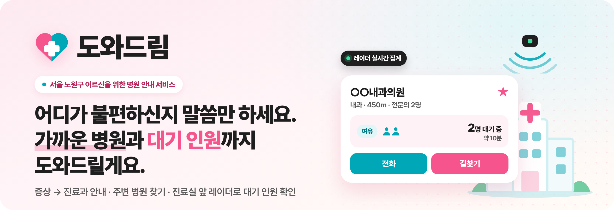
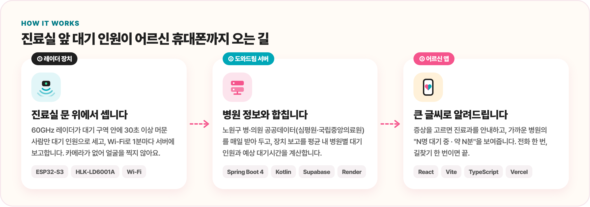
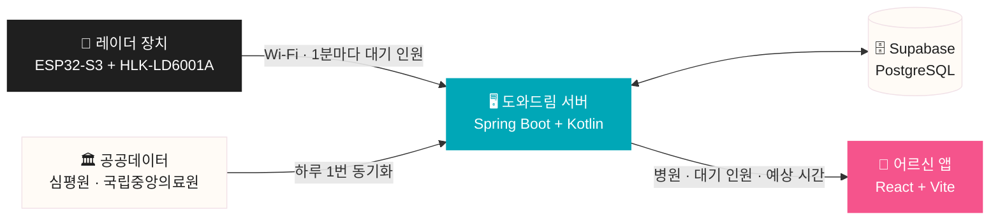
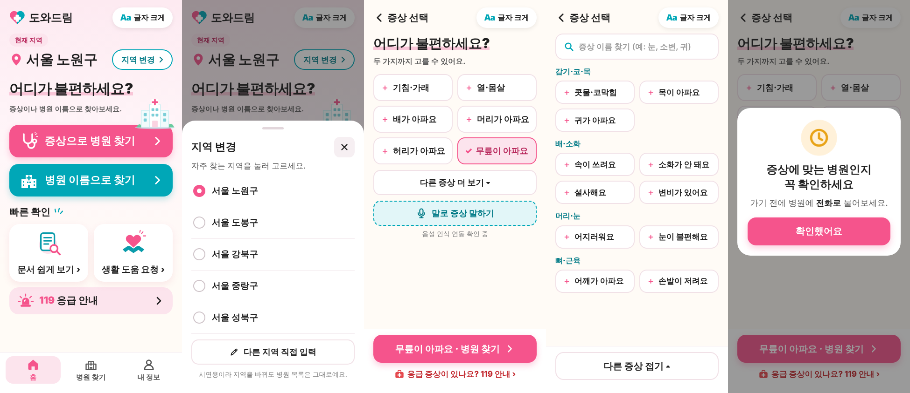
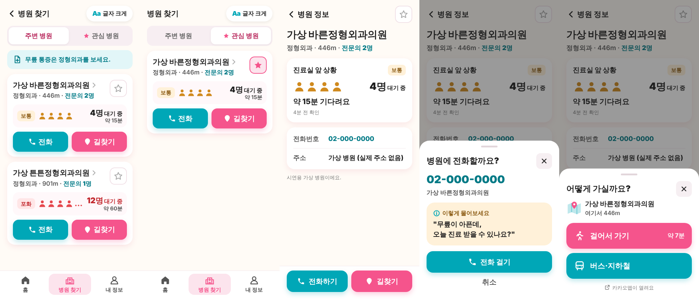

 

 

## 💗 도와드림은요

동네 의원에 가면 **얼마나 기다려야 하는지** 알 수 없고, 어디가 아플 때 **어느 진료과로 가야 하는지**도 헷갈립니다.
작은 글씨와 복잡한 화면은 어르신에게 또 하나의 벽이 되고요.

**도와드림**은 서울 노원구 어르신이 휴대폰으로 쉽게 병원을 찾도록 돕는 모바일 웹앱입니다.
증상을 고르면 맞는 진료과를 안내하고, 가까운 병원과 **진료실 앞 실시간 대기 인원**을 큰 글씨로 보여드려요.
대기 인원은 진료실 문 위에 단 **60GHz 레이더 장치**가 직접 셉니다.

<table>
  <tr>
    <td width="33%" valign="top">
      <h3>🩺 증상으로 찾기</h3>
      "무릎이 아파요", "어지러워요"처럼 큰 버튼을 누르면 맞는 진료과를 알려드려요. 진단이 아닌 안내이고, 응급 증상은 <b>119를 먼저</b> 안내합니다.
    </td>
    <td width="33%" valign="top">
      <h3>🏥 가까운 병원과 대기 인원</h3>
      노원구 병·의원 공공데이터로 주변 병원을 찾고, <b>"4명 대기 중 · 약 25분"</b>처럼 기다림을 미리 보여드려요.
    </td>
    <td width="33%" valign="top">
      <h3>📞 전화 한 번, 길찾기 한 번</h3>
      병원 카드에서 바로 전화를 걸거나 길을 찾아요. 전화할 때 <b>무엇을 물어보면 되는지</b>도 예시로 알려드려요.
    </td>
  </tr>
</table>

> **어르신 기준으로 만듭니다.** 본문 17px 이상, 버튼 글자 20px 이상, 화면마다 할 일은 하나. 필요 없는 정보는 과감히 뺍니다.

 

## 📡 어떻게 동작하나요

- 레이더는 **카메라가 아니어서** 얼굴이나 모습을 찍지 않고, 사람의 위치 좌표만 읽습니다.
- 대기 구역 안에 **30초 이상 머문 사람**만 대기 인원으로 세서, 지나가는 사람은 빠집니다.
- 문으로 들어온 인원이 아니라 **진료실 앞에 실제로 앉아 기다리는 인원**을 셉니다.

 

## 📱 화면 미리보기

 

## 🗂️ 저장소

| 저장소 | 하는 일 | 기술 |
|---|---|---|
| [**dowadream-FE**](https://github.com/dowadream-makers/dowadream-FE) | 어르신용 모바일 웹앱 화면 |     |
| [**dowadream-BE**](https://github.com/dowadream-makers/dowadream-BE) | 병원 정보·대기시간 API, 장치 보고 수신, 공공데이터 동기화 |     |
| [**dowadream-arduino**](https://github.com/dowadream-makers/dowadream-arduino) | 진료실 앞 대기 인원 측정 장치 펌웨어와 실시간 모니터 |    |

 

## 🗓️ 진행 상황

| 단계 | 기간 | 내용 | |
|---|---|---|:-:|
| 기획·설계 | 2026.10 ~ 11 | 계획서, 와이어프레임, 기술 스택, 부품 구매 | ✅ |
| 디자인 | 2026.11 | 피그마 시안, 전문가 자문 반영, 최종 화면 18장 | ✅ |
| 앱·서버 | 2026.11 ~ 12 | 증상 안내, 병원 검색, 대기시간 계산, 공공데이터 연동 | 🔄 |
| 레이더 장치 | 2026.11 ~ 12 | 좌표 모드 펌웨어, 대기 구역 판별, Wi-Fi 전송 | 🔄 |
| 통합·시연 | 2026.12 | 앱–장치 연동, 3D 프린팅 케이스, 시연 모형 | ⏳ |
| 마무리 | 2027.01 | 사용자 시나리오 테스트, 최종 발표·경진대회 | ⏳ |

 

## 👥 팀 도와드림

**인덕대학교** 컴퓨터소프트웨어학과 × 정보통신공학과가 함께 만듭니다.

| 컴퓨터소프트웨어학과 | 정보통신공학과 |
|---|---|
| 화면(UI), 증상 분류, 병원 검색·대기시간, 지도, 서버·DB | ESP32·레이더 하드웨어, 대기 인원 판별, Wi-Fi 통신, 3D 케이스 |

 

  
   
  <b>도와드림</b> · 어르신의 병원 가는 길을 도와드립니다
   
  인덕대학교 2026학년도 지역문제해결 메이커톤

